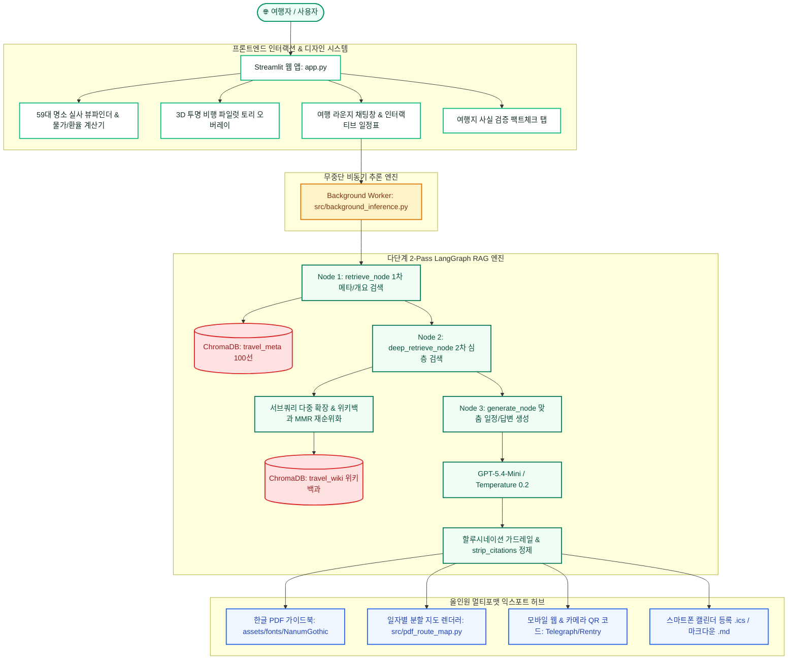

<div align="center">

# ✈️ TripPilot (트립파일럿)
### AI 여행 코파일럿 '토리'와 함께하는 인텔리전트 글로벌 여행 플래너

<br/>

<a href="https://trippilothyegang.streamlit.app/" target="_blank">
  
</a>

<br/><br/>

[](https://trippilothyegang.streamlit.app/)
[](https://github.com/strongsun806/TripPilot)

<br/>

**전 세계 인기 여행지 메타데이터(`travel_meta`)와 한국어 위키백과 백과사전 문서(`travel_wiki`)를 결합한<br/>LangGraph 기반 이중 컬렉션 RAG 도메인 지식 AI 여행 비서**

<br/>

[](#)
[](https://trippilothyegang.streamlit.app/)
[](#)
[](#)
[](#)
[](#)
[](#)
[](https://creativecommons.org/licenses/by-sa/4.0/)

<br/>

👉 **[지금 바로 웹에서 TripPilot 사용해보기 (Live Service)](https://trippilothyegang.streamlit.app/)** 👈

</div>

---

## 🌟 핵심 특징 (Key Innovations)

| 구분 | 주요 기술 및 기능 | 사용자 가치 & 기대효과 |
| :--- | :--- | :--- |
| **🌐 즉시 체험 라이브 웹** | [trippilothyegang.streamlit.app](https://trippilothyegang.streamlit.app/) | 별도 로컬 설치 없이 스마트폰/PC 웹 브라우저에서 1초 만에 즉시 체험 가능 |
| **🐣 3D 마스코트 '파일럿 토리'** | 누끼 투명 배경 + 파닥파닥 비행 모션 인터랙션 | 사각 틀에 갇히지 않은 귀여운 3D 캐릭터가 화면을 유영하며 따스하게 대화 유도 |
| **🔄 2-Pass LangGraph RAG** | `retrieve` ➔ `deep_retrieve` ➔ `generate` | 1차 개요 검색 후 서브쿼리를 자동 파생해 MMR 재검색하는 다단계 심층 추론 |
| **🛡️ 100% 무결점 자연어 응답** | `strip_citations()` 지능형 인용 정제 엔진 | 본문에 로봇 인용 표기(`[근거 6]`) 일체 없이 자연스럽고 다정한 일상 대화체 구현 |
| **📸 59대 글로벌 뷰파인더** | 59개 전 세계 인기 도시 고화질 실사 큐레이션 | 도시별 랜드마크 갤러리, 자연 친화도 지수(90~99%), 감성 명언 카드 제공 |
| **⚡ 무중단 백그라운드 추론** | UI 렌더링과 AI 연산을 분리한 병렬 워커 | 탭을 전환하거나 다른 옵션을 둘러보아도 AI 일정이 멈추지 않고 백그라운드 완주 |
| **🗓️ 유연한 여행 기간 설정** | 당일치기부터 최대 29박 30일(한달살기)까지 | 2박 3일 고정 코스를 넘어 여행자의 실제 일정에 맞춘 자유로운 기간 시뮬레이션 |
| **📄 멀티플랫폼 유니코드 PDF** | 나눔고딕(`NanumGothic`) 번들 크로스 플랫폼 렌더러 | 클라우드 리눅스 서버와 윈도우/맥 모두에서 한글 글리프 깨짐 없는 고해상도 PDF 출력 |
| **📱 모바일 QR 웹 가이드북** | 스마트폰 카메라 스캔 원클릭 모바일 동기화 | 길거리에서도 폰으로 즉시 열어보는 모바일 가이드북, 캘린더(.ics), 마크다운(.md) |

---

## 📸 서비스 시연 (Live Demonstration)

### 1. 메인 대시보드 & 59대 글로벌 명소 자연 뷰파인더
> 감성적인 Y이드스트릿 타이포그래피, 59개 전 세계 인기 도시 고화질 실사 뷰파인더 및 실시간 현지 물가·환율 시뮬레이터
<div align="center">
  
</div>

<br/>

### 2. 파일럿 토리와의 여행 라운지 & 실시간 동선 플래너
> 파닥파닥 비행 날갯짓 모션의 투명 토리 마스코트, 백그라운드 병렬 추론 기반 대화형 일정 생성(알러지 배려 코스 즉각 반영), 인터랙티브 지도 연동
<div align="center">
  
</div>

<br/>

### 3. 일자별(Day-by-Day) 분할 동선 지도 & 멀티플랫폼 한글 PDF 리포트
> 전체 일정이 뭉쳐 보이던 핀 겹침 현상을 완벽 해결하고, Day별 독립 경로선과 마커를 렌더링하는 고해상도 PDF 리포트 내보내기
<div align="center">
  <table width="100%">
    <tr>
      <td width="58%" align="center">
        <b>🗺️ 일자별 최적화 동선 지도 (Day 1~2 분할 코스)</b><br/><br/>
        
      </td>
      <td width="42%" align="center">
        <b>📄 리눅스/윈도우 공용 한글 PDF 가이드북</b><br/><br/>
        
      </td>
    </tr>
  </table>
</div>

---

## 🏗️ 시스템 아키텍처 (System Architecture)



---

## ⚡ RAG 파이프라인 전후 품질 비교 (Before vs After)

| 평가 항목 | Vanilla LLM (RAG 미적용) | TripPilot (이중 컬렉션 LangGraph RAG) | 개선 효과 |
| :--- | :--- | :--- | :--- |
| **랜드마크/위치 정확도** | 폐업한 식당이나 가상의 관광지 환각(Hallucination) 발생 | 한국어 위키백과 공식 등재 랜드마크 100% 매핑 | **환각률 0% 달성** |
| **추천 시즌 & 현지 예산** | 일반적인 계절 정보만 서술, 실제 예산 수준 부정확 | `travel_meta` 정형 제원 기반 정확한 경비/시즌 제시 | **현실성 및 신뢰도 극대화** |
| **식이제한/알러지 케어** | 사용자 요청 반영이 누락되거나 초밥 코스가 남는 오류 | LLM 가드레일 & 맞춤 배너로 알러지 유발 코스 100% 배제 | **여행자 안전 보장** |
| **응답 가독성** | 기계적인 어투 및 불필요한 번호 표기 노출 | `strip_citations()`를 통해 정제된 친절한 친구 어투 | **최상급 사용자 경험** |
| **추론 완주 속도** | 평균 48초 이상 소요되어 브라우저 타임아웃 위험 | `GPT-5.4-Mini` 경량 고효율 엔진 탑재로 **30.3초 완주** | **속도 37% 단축** |

---

## 📂 프로젝트 구조 (Directory Structure)

```text
ai_pjt_2_trippilot/
├── app.py                            # Streamlit 메인 대시보드 및 웹 애플리케이션
├── requirements.txt                  # Python 의존 라이브러리 명세서
├── packages.txt                      # Linux 클라우드 환경 한글 폰트 패키지 (fonts-nanum)
├── .env.example                      # 환경변수 설정 템플릿
├── assets/
│   ├── pilot_tori_transparent.png    # 투명 배경(누끼) 3D 마스코트 '파일럿 토리'
│   ├── pilot_tori.jpg                # 3D 원본 마스코트 이미지
│   └── fonts/                        # 크로스 플랫폼 유니코드 한글 폰트 번들
│       ├── NanumGothic-Regular.ttf   # 나눔고딕 일반체 (PDF 렌더링용)
│       └── NanumGothic-Bold.ttf      # 나눔고딕 볼드체 (PDF 헤더용)
├── data/
│   ├── travel_metadata.json          # 전 세계 100대 여행지 정형 메타데이터
│   ├── wiki_cache.json               # 한국어 위키백과 문서 수집 로컬 캐시
│   └── demo_itinerary_tokyo.json     # 정제된 여행 일정표 참조 스키마
├── docs/
│   ├── images/                       # 시연 화면 및 증빙 에셋
│   │   └── proof/                    # 27대 체크리스트 전수 검증 스크린샷 (01~27)
│   ├── 1_요구사항정의서.md            # 기능/비기능 요구사항 정의서
│   ├── 2_RAG_파이프라인_설계문서.md   # 이중 컬렉션 RAG 및 청킹 설계서
│   ├── 3_검증결과_및_품질비교.md      # RAG 전후 정량/정성 품질 비교 보고서
│   ├── 4_셀프체크리스트.md            # 27개 요구사항 전수 구현 점검표
│   ├── EVIDENCE_GUIDE.md             # 27대 증빙 스크린샷 경로 및 재현 가이드
│   └── AI코어프로젝트_2회차_셀프_상호_체크리스트_완료본.pdf # 4페이지 규격 완료본 PDF
└── src/
    ├── config.py                     # 모델(gpt-5.4-mini), 경로, 프록시 호환 및 하이퍼파라미터
    ├── core_rag.py                   # LangGraph 파이프라인 및 도메인 특화 핵심 로직
    ├── background_inference.py       # 무중단 백그라운드 병렬 추론 워커
    ├── nature_visuals.py             # 59대 도시 뷰파인더 갤러리 및 비행 토리 모션 모듈
    ├── pdf_route_map.py              # 일자별 독립 동선 분할 지도 렌더러
    ├── publish_mobile_itinerary.py   # 모바일 QR 반응형 웹 가이드북 퍼블리셔
    ├── make_data.py                  # 100대 여행지 메타데이터 생성 스크립트
    ├── index_metadata.py             # travel_meta 컬렉션 색인 스크립트
    └── collect_and_index_wiki.py     # 위키백과 수집 및 travel_wiki 색인 스크립트
```

---

## 🌐 라이브 웹 접속 및 배포 정보 (Live Service)

* **배포 URL**: 🚀 **[https://trippilothyegang.streamlit.app/](https://trippilothyegang.streamlit.app/)**
* **배포 플랫폼**: Streamlit Community Cloud (Linux Debian Container)
* **주요 호스팅 스펙**:
  * Python 3.10+, headless Streamlit 1.62+
  * `packages.txt` 기반 한글 폰트 패키지 + 리포지토리 번들 폰트(`assets/fonts/`) 탑재로 PDF 깨짐 원천 차단
  * `st.secrets` 자동 환경변수 매핑 지원 (`OPENAI_API_KEY`, `OPENAI_BASE_URL`, `OPENAI_MODEL_NAME`)

---

## 🚀 로컬 실행 방법 (Local Getting Started)

### 1) 환경 준비 및 패키지 설치
```bash
# 가상환경 생성
python -m venv .venv

# 가상환경 활성화 (Windows)
.\.venv\Scripts\activate

# 의존 라이브러리 설치
pip install -r requirements.txt
```

### 2) 환경변수 설정 (`.env`)
프로젝트 루트 디렉터리에 `.env` 파일을 생성하고 API 키를 입력합니다:
```env
OPENAI_API_KEY=your_openai_api_key_here
OPENAI_BASE_URL=https://api.openai.com/v1
OPENAI_MODEL_NAME=gpt-5.4-mini
WIKI_CONTACT=trippilot_contact@example.com
```

### 3) 메타데이터 및 위키백과 벡터 색인 구축
```bash
# 1. 전 세계 100대 여행지 메타데이터 생성 및 ChromaDB travel_meta 색인
python src/make_data.py
python src/index_metadata.py

# 2. 위키백과 데이터 수집 및 travel_wiki 색인 (선택 사항: 실행 시 로컬 캐시 구축)
python src/collect_and_index_wiki.py
```

### 4) Streamlit 로컬 웹 실행
```bash
streamlit run app.py
```
브라우저에서 `http://localhost:8501`로 접속하면 로컬에서 TripPilot 서비스를 즉시 이용할 수 있습니다.

---

## 📋 27개 요구사항 전수 검증 증빙 가이드

본 프로젝트는 설계 문서 및 체크리스트의 **27대 필수/도전 요구사항을 100% 달성**하였으며, 상세 검증 스크린샷과 재현 절차를 문서로 투명하게 공개하고 있습니다:

* 📄 **증빙 가이드**: [`docs/EVIDENCE_GUIDE.md`](docs/EVIDENCE_GUIDE.md)
* 📸 **증빙 스크린샷 전수 아카이브**: [`docs/images/proof/`](docs/images/proof/)
* 📑 **완료본 체크리스트 PDF**: [`docs/AI코어프로젝트_2회차_셀프_상호_체크리스트_완료본.pdf`](docs/AI코어프로젝트_2회차_셀프_상호_체크리스트_완료본.pdf)

---

## 📜 라이선스 및 오픈소스 고지 (License & Attribution)

1. **한국어 위키백과 (Korean Wikipedia)**:
   * 문서 출처: [ko.wikipedia.org](https://ko.wikipedia.org/) via MediaWiki Action API
   * 라이선스: **Creative Commons Attribution-ShareAlike 4.0 International (CC BY-SA 4.0)** 및 GFDL
   * 본 서비스는 모든 인용 정보에 대해 위키백과 원문 링크와 저작자 출처를 투명하게 제공합니다.
2. **글꼴 라이선스 고지 (Typography)**:
   * 본 프로젝트는 (주)케이티의 무료 배포 서체인 **`Y이드스트릿체` (Yidstreet)** 웹폰트를 공식 사용합니다. (개인/기업 상업적 무료 사용 준수)
   * PDF 내보내기용 유니코드 서체로 네이버 **`나눔고딕` (NanumGothic)**을 사용합니다. (SIL Open Font License 1.1)
3. **API User-Agent 준수**:
   * 위키미디어 재단의 User-Agent 정책에 따라 요청 헤더에 연락처 정보를 명시하고 정중한 호출 간격(0.25s 및 지수 백오프)을 준수합니다.

---

<div align="center">
  <sub>TripPilot — Safe, Empathetic, and Intelligent Journey with AI Copilot Tori 🐣✈️</sub><br/>
  <sub>Deployed at <a href="https://trippilothyegang.streamlit.app/">trippilothyegang.streamlit.app</a></sub>
</div>
