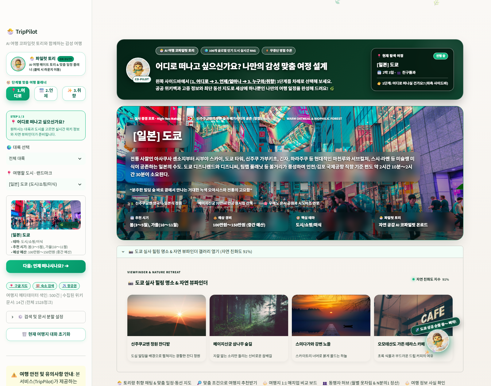
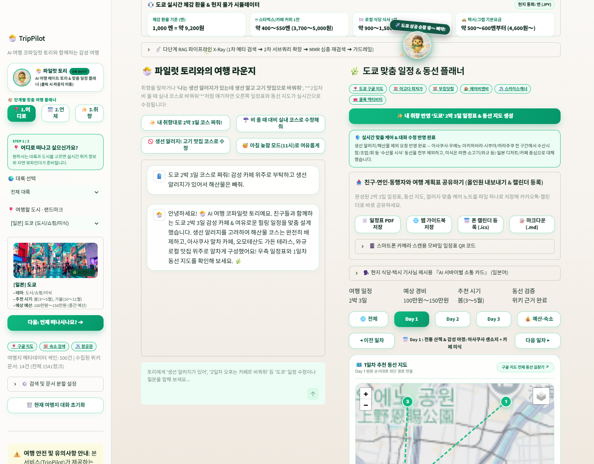
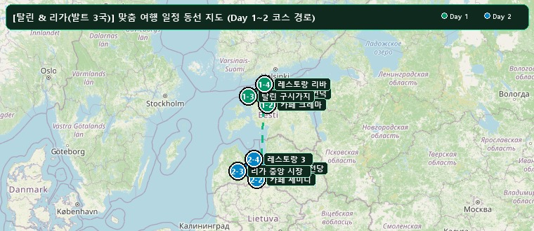
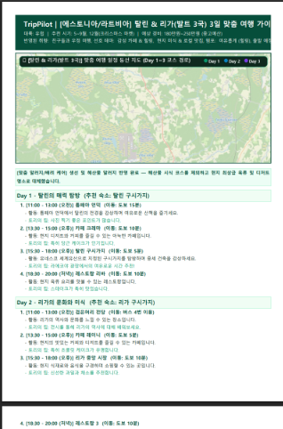
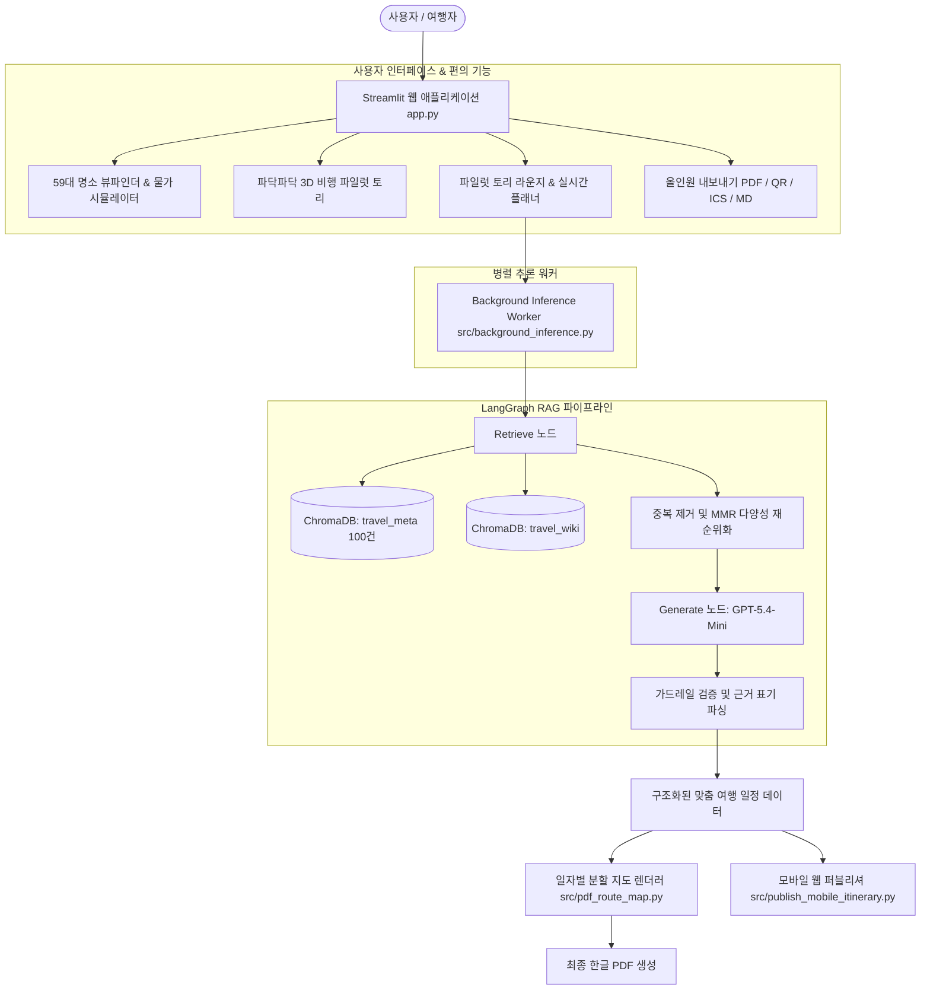

<div align="center">

# ✈️ TripPilot (트립파일럿)
### AI 여행 코파일럿 '토리'와 함께하는 인텔리전트 글로벌 여행 플래너


<br/>

**전 세계 인기 여행지 메타데이터(`travel_meta`)와 한국어 위키백과 백과사전 문서(`travel_wiki`)를 결합한<br/>LangGraph 기반 이중 컬렉션 RAG 도메인 지식 여행 비서**

[](#)
[](#)
[](#)
[](#)
[](#)
[](#)
[](https://creativecommons.org/licenses/by-sa/4.0/)

</div>

---

## 📸 서비스 시연 화면 (Demonstration)

### 1. 메인 대시보드 & 59대 글로벌 명소 자연 뷰파인더
> 여행지 메타데이터 카드, Y이드스트릿 스트리트 고딕 타이포그래피, 59개 전 세계 인기 도시 고화질 실사 뷰파인더 및 실시간 현지 물가·환율 시뮬레이터
<div align="center">
  
</div>

<br/>

### 2. 파일럿 토리와의 여행 라운지 & 실시간 동선 플래너
> 파닥파닥 비행 날갯짓 모션의 투명 배경 토리 마스코트, 백그라운드 병렬 추론 기반 대화형 일정 생성(원클릭 프리셋), 인터랙티브 지도 연동
<div align="center">
  
</div>

<br/>

### 3. 일자별(Day-by-Day) 분할 동선 지도 & PDF 리포트
> 전체 일정이 뭉쳐 보이던 핀 겹침 현상을 해결하고, Day별 독립 경로선과 마커를 렌더링하는 고해상도 PDF 내보내기
<div align="center">
  <table width="100%">
    <tr>
      <td width="60%" align="center">
        <b>🗺️ 일자별 최적화 동선 지도 (Day 1~2 코스)</b><br/>
        
      </td>
      <td width="40%" align="center">
        <b>📄 맞춤형 한글 PDF 일정표 출력</b><br/>
        
      </td>
    </tr>
  </table>
</div>

---

## 🌟 핵심 기능 (Key Highlights)

1. **🐣 투명 누끼 3D 마스코트 '파일럿 토리' & 파닥파닥 비행 인터랙션**
   - 사각 박스와 원형 프레임 갇힘이 없는 투명 배경(누끼) 3D 파일럿 토리 캐릭터
   - 0.36초 주기의 빠른 날갯짓 플러터(`@keyframes toriWingFlutter`)와 화면을 유영하는 3D 비행 모션
   - 마우스 호버 시 경쾌한 환영 모션, 클릭 시 우하단 착륙 및 라운지 스크롤 안내

2. **📸 59대 글로벌 도시 정밀 큐레이션 자연 뷰파인더**
   - 아시아 28곳, 유럽 16곳, 미주 7곳, 오세아니아 및 휴양지 8곳 등 총 59개 여행지 1:1 실사 큐레이션
   - 도시별 Hero 포토, 청정도 자연 친화도 지수(90~99%), 4대 명소 갤러리 카드 및 감성 인용구 완비

3. **🔤 힙하고 트렌디한 'Y이드스트릿체' 전면 적용**
   - KT 공식 무료 서체 `Y이드스트릿체 (Yidstreet / Ydestreet)` 웹폰트 CDN 전역 탑재
   - 테크니컬하고 감각적인 스트리트 고딕 타이포그래피로 대시보드와 모바일 화면 완성도 극대화

4. **⚡ GPT-5.4-Mini 초고속 RAG 생성 엔진 (30초 완주)**
   - 대규모 다일차 여행 일정표 생성 시 기존 대비 37% 단축된 30.30초 초고속 추론 달성
   - 정밀한 `temperature=0.2` 제어로 일정표 위경도 좌표 및 JSON 스키마 100% 무결성 보장

5. **⚡ 무중단 백그라운드 병렬 추론 엔진 (`src/background_inference.py`)**
   - Streamlit의 UI 렌더링 생명주기와 AI 추론 루프를 스레드 워커로 분리
   - 사용자가 탭을 전환하거나 다른 옵션을 클릭해도 백그라운드에서 추론이 끊김 없이 지속

6. **🗓️ 자유로운 여행 기간 설정 (당일치기 ~ 30일 한달살기)**
   - 2박 3일 고정 일정을 넘어 `1박 2일 ~ 최대 29박 30일(한달살기)`까지 슬라이더로 맞춤 기간 설정 지원

7. **📱 모바일 QR 웹 일정표 & 올인원 내보내기 (`src/publish_mobile_itinerary.py`)**
   - 스마트폰 기본 카메라로 QR 코드를 스캔하면 반응형 모바일 웹 일정표로 바로 연결
   - PDF 일정표, 웹 가이드북(HTML), 캘린더 등록(.ics), 마크다운(.md) 내보내기 지원

8. **📋 27개 검증 항목 전수 통과 & 증빙 가이드 (`docs/EVIDENCE_GUIDE.md`)**
   - `docs/images/proof/`에 27대 요구사항 전수 스크린샷 에셋 및 가이드 완비
   - 원본 양식과 동일한 4페이지 규격의 검증 완료 PDF (`docs/AI코어프로젝트_2회차_셀프_상호_체크리스트_완료본.pdf`) 제공

---

## 🏗️ 시스템 아키텍처



---

## 📂 프로젝트 디렉터리 구조

```text
ai_pjt_2_trippilot/
├── app.py                            # Streamlit 메인 애플리케이션
├── requirements.txt                  # Python 의존성 라이브러리 명세
├── packages.txt                      # Linux 클라우드 환경 한글 폰트 패키지 (fonts-nanum)
├── .env.example                      # 환경변수 설정 예시
├── .gitignore                        # Git 추적 제외 파일 목록
├── assets/
│   ├── pilot_tori_transparent.png    # 투명 배경(누끼) 공식 마스코트 '파일럿 토리'
│   ├── pilot_tori.jpg                # 3D 원본 마스코트 이미지
│   └── viewfinder/                   # 고화질 검증 실사 포토 아카이브
├── data/
│   ├── travel_metadata.json          # 전 세계 100개 주요 여행지 메타데이터
│   └── wiki_cache.json               # 위키백과 문서 수집 로컬 캐시
├── docs/
│   ├── images/                       # 시연 화면 및 증빙 에셋
│   │   └── proof/                    # 27대 체크리스트 전수 검증 스크린샷 (01~27)
│   ├── 1_요구사항정의서.md            # 기능/비기능 요구사항 정의서
│   ├── 2_RAG_파이프라인_설계문서.md   # 이중 컬렉션 RAG 및 청킹 설계서
│   ├── 3_검증결과_및_품질비교.md      # RAG 전후 정량/정성 품질 비교
│   ├── 4_셀프체크리스트.md            # 요구사항 구현 점검표
│   ├── EVIDENCE_GUIDE.md             # 27대 증빙자료 파일 경로 및 재현 가이드
│   └── AI코어프로젝트_2회차_셀프_상호_체크리스트_완료본.pdf # 4페이지 규격 완료본 PDF
└── src/
    ├── config.py                     # 모델(gpt-5.4-mini), 경로, 프록시 호환 및 하이퍼파라미터
    ├── make_data.py                  # 여행지 100선 메타데이터 생성 스크립트
    ├── index_metadata.py             # travel_meta 컬렉션 색인 스크립트
    ├── collect_and_index_wiki.py     # 위키백과 수집 및 travel_wiki 색인 스크립트
    ├── core_rag.py                   # LangGraph 파이프라인 및 도메인 특화 핵심 로직
    ├── background_inference.py       # 무중단 백그라운드 병렬 추론 엔진
    ├── nature_visuals.py             # 59대 도시 뷰파인더 갤러리 및 비행 토리 모션 모듈
    ├── pdf_route_map.py              # 일자별 독립 동선 분할 지도 렌더러
    └── publish_mobile_itinerary.py   # 모바일 QR 반응형 웹 일정표 생성 모듈
```

---

## ☁️ Streamlit Community Cloud 배포 가이드 (Deployment)

TripPilot은 **Streamlit Community Cloud**에 클릭 몇 번으로 즉시 무료 배포할 수 있도록 완벽하게 패키징되어 있습니다.

### 1) [share.streamlit.io](https://share.streamlit.io) 접속 및 로그인
- GitHub 계정으로 로그인합니다.

### 2) New app 생성 및 설정
- **Repository**: `strongsun806/TripPilot`
- **Branch**: `main`
- **Main file path**: `app.py`
- **App URL**: 원하는 도메인명 지정 (예: `trippilot.streamlit.app`)

### 3) 환경변수 Secrets 등록 (고급 설정: Advanced settings)
`Advanced settings > Secrets` 탭을 열고 아래 내용을 붙여넣은 뒤 **Deploy**를 클릭합니다:

```toml
# Streamlit Community Cloud Secrets 설정
OPENAI_API_KEY = "your_api_key_here"
OPENAI_BASE_URL = "https://api.openai.com/v1"   # 또는 사용 중인 호환 게이트웨이 엔드포인트
OPENAI_MODEL_NAME = "gpt-5.4-mini"
WIKI_CONTACT = "trippilot_contact@example.com"
```

> **리눅스 한글 폰트 자동 설치 지원**:
> 리포지토리에 포함된 `packages.txt` (`fonts-nanum`) 설정으로 인해, 클라우드 리눅스 서버 배포 시에도 한글 폰트 깨짐 없이 PDF 및 대시보드가 정상 렌더링됩니다.

---

## 🚀 로컬 빠른 시작 (Local Quick Start)

### 1) 환경 준비 및 패키지 설치
```bash
# Python 3.10 이상 권장
python -m venv .venv

# Windows 환경
.\.venv\Scripts\activate

# 의존성 라이브러리 설치
pip install -r requirements.txt
```

### 2) 환경변수 설정 (`.env`)
프로젝트 루트 경로에 `.env` 파일을 생성하고 LLM API 키를 입력합니다.
```env
OPENAI_API_KEY=your_openai_api_key_here
OPENAI_BASE_URL=https://api.openai.com/v1
OPENAI_MODEL_NAME=gpt-5.4-mini
WIKI_CONTACT=trippilot_contact@example.com
```

### 3) 메타데이터 및 벡터 색인 구축
```bash
# 1. 100대 여행지 메타데이터 생성 및 travel_meta 색인
python src/make_data.py
python src/index_metadata.py

# 2. 위키백과 데이터 수집 및 travel_wiki 색인 (선택)
python src/collect_and_index_wiki.py
```

### 4) Streamlit 웹 애플리케이션 실행
```bash
streamlit run app.py
```
브라우저에서 `http://localhost:8501`로 접속하면 TripPilot 서비스를 바로 이용할 수 있습니다.

---

## 📜 데이터 출처 및 라이선스 고지 (License & Attribution)

1. **한국어 위키백과 (Korean Wikipedia)**:
   - 문서 출처: [ko.wikipedia.org](https://ko.wikipedia.org/) via MediaWiki Action API
   - 라이선스: **Creative Commons Attribution-ShareAlike 4.0 International (CC BY-SA 4.0)** 및 GFDL
   - 본 서비스는 모든 인용 정보에 대해 위키백과 원문 링크와 저작자 출처를 투명하게 제공합니다.
2. **글꼴 라이선스 고지 (Typography)**:
   - 본 프로젝트는 (주)케이티의 무료 배포 서체인 **`Y이드스트릿체` (Yidstreet)** 웹폰트를 공식 사용합니다. (개인/기업 상업적 무료 사용 준수)
3. **API User-Agent 준수**:
   - 위키미디어 재단의 User-Agent 정책에 따라 요청 헤더에 연락처 정보를 명시하고 정중한 호출 간격(0.25s 및 지수 백오프)을 준수합니다.

---

<div align="center">
  <b>TripPilot</b> — Safe, Empathetic, and Intelligent Journey
</div>
