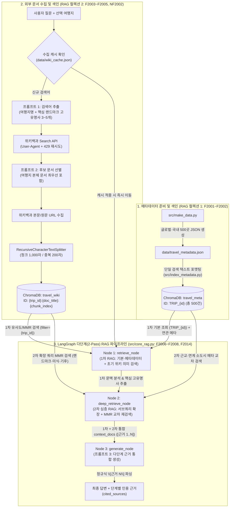

# 2. RAG 파이프라인 설계 문서 — TripPilot

> 본 문서는 명세서 2장(프로젝트 기획) 및 6장 2절(RAG 파이프라인 설계문서 제출 요건)의 모든 필수 항목을 포함하여 작성되었다.

---

## 2.1 전체 파이프라인 구조 및 데이터 흐름 (다단계 2-Pass Multi-Hop RAG 설계)

`TripPilot`은 **정형 여행지 메타데이터(`travel_meta`, 총 500건)**와 **외부 한국어 위키백과 문서(`travel_wiki`)**를 분리 색인하고, 단일 검색의 한계를 극복하기 위해 **LangGraph 기반 다단계(2-Pass / Multi-Hop) RAG 워크플로우 (`retrieve` [1차 RAG] ➔ `deep_retrieve` [2차 심층 RAG] ➔ `generate` [근거 통합 생성])** 구조로 설계하였다.



### 왜 단일 RAG가 아닌 2단계(Multi-Stage) RAG를 적용하였는가?
1. **1차 RAG (`retrieve_node`) — 거시적 기본 제원 및 초기 문맥 확보**:
   - 사용자가 `"삿포로 겨울 여행 코스와 명소 알려줘"`라고 질문하면, 1차 RAG에서 `travel_meta`(500곳)의 삿포로 기본 제원(`TRIP_5`: 오도리 공원, 스스키노, 모이와산, 눈축제, 예산, 추천 시즌)과 `travel_wiki`의 초기 관련 문단을 먼저 확보한다.
2. **2차 심층 RAG (`deep_retrieve_node`) — 1차 문맥 기반 서브쿼리 확장(Query Expansion) 및 MMR 교차 재검색**:
   - 단일 검색만 수행할 경우 사용자의 짧은 질문에 직접 포함되지 않은 세부 명소(예: `'오도리 공원 눈축제'`, `'모이와산 야경'`, 인접 소도시 `'오타루 운하'`, `'비에이 청의 호수'`)의 상세 위키 청크가 누락될 수 있다.
   - `deep_retrieve_node`는 1차 RAG에서 검색된 메타데이터 요약과 초기 위키 문맥을 분석하여 **2개의 구체적인 확장 서브쿼리(`expanded_queries`)**를 동적으로 생성하고, `travel_wiki`와 `travel_meta` 양쪽 컬렉션에 대해 **2차 MMR(Maximal Marginal Relevance) 다양성 재검색**을 수행한다.
   - 이를 통해 1차 검색에서 놓친 세부 랜드마크 역사, 향토 미식, 근교 연계 도시 정보까지 빠짐없이 보강하여 답변과 2박 3일 일정표의 완결성을 극대화하였다.

---

## 2.2 항목 텍스트 설계 (F2001)

- **설계 목적**: 사용자가 여행지명, 국가, 대륙, 여행 테마(휴양지/역사/미식/자연/도시 등), 예산 수준(100만원 이하 저예산/가성비 ~ 300만원 이상 럭셔리), 추천 여행 시기(건기/계절), 대표 랜드마크 중 **어느 조건으로 검색하더라도 누락 없이 걸리도록** 모든 핵심 속성을 하나의 완결된 색인 텍스트로 묶었다.
- **단일 색인 텍스트 템플릿**:
  ```text
  [여행지 메타데이터] 여행지명: {name} | 국가: {country} | 대륙: {continent} | 테마: {theme} | 예산 수준: {budget_level} | 추천 여행 시기(베스트 시즌): {best_season} | 요약 설명: {summary}
  ```
- **실제 생성 예시 (`TRIP_7` - 다낭)**:
  ```text
  [여행지 메타데이터] 여행지명: 다낭 | 국가: 베트남 | 대륙: 아시아 | 테마: 휴양지/리조트/가족여행 | 예산 수준: 100만원 이하 (저예산/가성비) | 추천 여행 시기(베스트 시즌): 건기(2~5월) | 요약 설명: 미케 비치의 아름다운 해변과 가성비 높은 5성급 풀빌라 리조트, 바나힐 골든브릿지, 오행산, 인근 호이안 올드타운까지 아우르는 베트남 대표 휴양지. 예산 100만원 이하 휴양지로 가장 인기가 높다.
  ```

---

## 2.3 두 개의 Vector DB 컬렉션 구조와 메타데이터 필드 설계 (F2002, F2005)

영속 디렉터리 `./chroma_db` 내부에 역할이 다른 두 컬렉션(`travel_meta`, `travel_wiki`)을 분리하여 구성하였다.

| 설계 항목 | 컬렉션 1: `travel_meta` (항목 메타데이터) | 컬렉션 2: `travel_wiki` (외부 위키백과 문서) |
| :--- | :--- | :--- |
| **역할** | 글로벌·국내 500곳 여행지의 공식 요약 정보 보관 및 자연어 조건 탐색(F2011) | 여행지별 상세 역사, 지리, 기후, 대표 랜드마크·명소 본문 청크 보관 |
| **청크 단위** | 여행지 1곳당 1개 청크 (총 500개 고정, 최소 기준 100건의 5배) | 위키 문서 본문을 1,000자(200자 중복)로 분할한 다수 청크 |
| **청크 식별자(ID) 규칙** | `TRIP_{id}` (예: `TRIP_1` ~ `TRIP_500`) | `{trip_id}:{doc_title}:{chunk_index}` (예: `5:삿포로시:0`, `7:다낭:0`) |
| **중복/덮어쓰기 방지 원리** | 동일 `TRIP_{id}`로 `add_documents` 호출 시 기존 청크를 덮어써 재실행 시에도 항상 500건 유지 | 앞에 `{trip_id}`를 붙여 여러 여행지가 공통 문서(예: `유네스코 세계유산`, `베트남`)를 수집해도 서로 덮어쓰지 않고, 동일 여행지 재수집 시에는 정확히 덮어씀 |
| **저장 메타데이터 필드** | `trip_id`, `name`, `country`, `continent`, `theme`, `budget_level`, `best_season` | `trip_id`, `dest_name`, `doc_title`, `page_id`, `source_url`, `source_type`, `chunk_id`, `collected_at` |

### 컬렉션을 두 개로 분리한 이유
1. **핵심 여행지 속성(예산·추천 시즌) 누락 원천 방지**: 단일 컬렉션에 짧은 메타데이터 요약(200자)과 긴 위키백과 본문 청크(1,000자)를 섞어 넣으면, 역사나 랜드마크 세부 질문 시 기본 메타데이터 청크가 유사도 순위에서 밀려 예산 수준이나 추천 시즌 같은 핵심 정보를 놓칠 수 있다. 컬렉션을 분리하여 선택 여행지의 `travel_meta` 청크는 검색 없이 **항상 `[근거 1]`로 기본 포함**시킨다.
2. **여행지 범위 필터링(`trip_id`)**: `travel_wiki` 검색 시 `filter={"trip_id": str(trip_id)}`를 적용하여 다른 도시(예: 다낭 질문 시 하노이나 호치민)의 위키 문서 청크가 근거에 섞여 들어오는 문제를 차단한다.

---

## 2.4 문서 수집·청킹·색인 및 병합·중복 제거 흐름 (F2003~F2006)

### 1) 문서 수집·청킹·색인 순서 (`src/collect_and_index_wiki.py`)
1. **검색어 추출 (프롬프트 1)**: 선택 여행지명과 사용자 질문을 분석해 3~5개 위키백과 검색어를 JSON 배열로 추출한다(첫 번째 키워드는 항상 여행지명 강제).
2. **수집 캐시 확인 (`NF2002`)**: `data/wiki_cache.json`을 조회하여 해당 여행지에 대해 이미 수집·색인된 검색어는 건너뛰고 신규 검색어만 위키백과 API로 요청한다.
3. **후보 검색 (`search_wiki_candidates`)**: MediaWiki `list=search` API로 검색어당 상위 후보의 제목(`title`)과 요약(`snippet`)을 수집한다.
4. **후보 선별 및 본문 수집 (프롬프트 2)**: 후보 목록(제목+요약)을 LLM에 제시해 여행지·지리·역사·관광과 무관한 동음이의어 문서(예: 인명, 소설, 스포츠 경기 등)를 버리고 유효 문서만 선별한다. 이때 **선택 여행지 자체를 다룬 문서는 어떤 제외 규칙보다 우선해 무조건 포함**한다.
5. **청킹 및 `travel_wiki` 색인**: 선별된 문서 본문을 `RecursiveCharacterTextSplitter(chunk_size=1000, chunk_overlap=200)`로 분할해 `{trip_id}:{doc_title}:{chunk_index}` ID와 함께 `travel_wiki`에 적재한다.

### 2) 검색 결과 병합 및 중복 제거 방식 (`src/core_rag.py` — `retrieve_node`)
1. `travel_meta`에서 `ids=[f"TRIP_{trip_id}"]`로 해당 여행지의 요약 메타데이터 청크 1건을 가져와 `merged_docs` 첫 번째 원소(`[근거 1]`)로 넣는다.
2. `travel_wiki`에서 `filter={"trip_id": trip_id}` 조건으로 질문과 가장 유사한 상위 `Top-k`(기본 3개) 청크를 검색한다(유사도 검색 또는 MMR 검색 선택 가능).
3. `seen_texts`(문자열 집합)를 사용하여 `page_content.strip()`이 동일한 청크는 제외함으로써 중복 청크가 컨텍스트에 들어가는 것을 방지한다.

---

## 2.5 프롬프트 3종 설계 (역할 · 제약 · 출력 형식)

| 구분 | 프롬프트 1: 검색어 추출 | 프롬프트 2: 후보 문서 선별 | 프롬프트 3: 근거 기반 답변 생성 |
| :--- | :--- | :--- | :--- |
| **구현 함수** | `extract_search_keywords` | `filter_and_collect_docs` | `generate_node` |
| **부여 역할** | 20년 경력의 글로벌 여행 큐레이터 및 지리·문화·관광 전문 컨설턴트 | 글로벌 여행 정보 및 지리·역사 백과사전 문서 선별 전문가 | 글로벌 여행지 추천 및 일정·지리·역사 분석 전문 AI `TripPilot` |
| **핵심 규칙** | 여행지명+질문에서 위키백과 검색어 3~5개 도출, **선택 여행지명 자체를 첫 번째 원소로 필수 포함** | 검색 후보(제목+요약) 중 동음이의어/무관 문서를 버리고 여행 연관 문서만 채택, **여행지 본체 문서는 무조건 포함** | **오직 `[참조 문서]` 내용만 사용**, 문장마다 `[근거 N]` 인용 표기, 문서에 없으면 `"제공된 문서에서 확인되지 않습니다"` 출력 |
| **출력 형식** | 파싱 가능한 JSON 문자열 배열 (`["다낭", "미케 비치", "오행산", ...]`) | 파싱 가능한 JSON 문자열 배열 (`["다낭", "오행산 (다낭)", "바나힐"]`) | `[근거 N]` 인용이 포함된 한국어 가이드 답변 문자열 |

> **선별 프롬프트(프롬프트 2)를 따로 둔 이유**: 위키백과 전문(`extracts`)을 무조건 다 받아오면 동음이의어 문서(예: `파리` 검색 시 곤충 '파리', `니스` 검색 시 목재 도료 '니스')까지 본문을 호출·임베딩하게 되어 API 호출 횟수와 벡터 DB 노이즈가 급증한다. 본문을 받기 전에 가벼운 제목·요약(`snippet`)만으로 버릴 문서를 먼저 걸러내어 외부 API 호출 수와 색인 품질을 동시에 최적화하였다.

---

## 2.6 청크 크기 · 중복 길이 · Top-k 선정 이유 및 값 변경 비교 (2.5 검색 설정 설계)

모든 설정값은 `src/config.py` 및 Streamlit 사이드바 설정 패널로 분리하여 코드 수정 없이 즉시 변경·비교할 수 있다.

### 1) 청크 크기(`CHUNK_SIZE = 1000`) 및 중복 길이(`CHUNK_OVERLAP = 200`) 선정 이유와 변경 시 차이
| 설정 조합 | 다낭 관련 수집 문서 색인 시 청크 특성 | 검색 및 답변 품질 차이 분석 |
| :--- | :--- | :--- |
| **500자 / 중복 50자** | 청크 수 약 1.8배 증가 | 청크가 너무 잘게 쪼개져 '기후(건기/우기 월별 특징)' 문단과 '주요 관광지 설명'이 서로 다른 청크로 분리됨. `Top-k=3`만 가져올 때 일정표 생성 시 명소 정보가 일부 누락되는 현상 발생 |
| **1,000자 / 중복 200자 (선정값)** | 문단 완결성 최적 | 위키백과의 섹션 단위(개요, 역사, 지리·기후, 관광 명소, 교통)가 한 청크 안에 온전히 담기며, 200자 중복 덕분에 문단 경계면의 지명·연도·수치 유실이 없음 |
| **1,500자 / 중복 300자** | 청크 수 감소, 노이즈 증가 | 한 청크에 여러 소주제(행정구역+자매결연도시+인구통계)가 섞여 임베딩 벡터의 주제 집중도가 흐려지고 불필요한 문맥 토큰 소모가 증가함 |

### 2) 검색 근거 수(`WIKI_TOP_K = 3`) 선정 이유와 변경 시 차이
- **구성**: `travel_meta` 기본 요약 1건(`[근거 1]`) + `travel_wiki` 외부 문서 청크 `Top-k`건을 합쳐 총 `1 + k`건의 근거를 LLM에 전달한다.
- **값 변경 실험 결과**:
  - `Top-k = 1` (총 2건): 기본 메타데이터 외에 위키 청크를 단 1개만 가져오므로, 복합 질문(예: 기후 특징 + 랜드마크 역사 + 교통편)이나 2박 3일 일정 생성에서 세부 명소 근거가 부족함.
  - **`Top-k = 3` (총 4건, 선정값)**: 여행지 핵심 메타데이터(`[근거 1]`)와 위키백과의 핵심 단락 3개(`[근거 2~4]`)가 결합되어 사실 정확도와 응답 속도(약 2~4초)의 균형이 가장 우수함.
  - `Top-k = 6` 이상 (총 7건+): 질문과 관련성이 낮은 자매결연 도시·역대 시장 목록 청크까지 포함되면서 LLM 집중도가 분산되고 입력 토큰 비용이 증가함.

---

## 2.7 답변에 근거를 표시하는 방식 (F2008)

1. `retrieve_node`가 반환한 `context_docs` 리스트의 각 문서에 1번부터 순서대로 `[근거 1]`, `[근거 2]`, ... 번호와 출처 유형(`여행지 메타데이터` / `한국어 위키백과`), 문서 제목을 부여해 프롬프트 3에 주입한다.
2. LLM이 답변 본문(및 2박 3일 일정표의 인용 근거 열) 내에 `[근거 1]`, `[근거 2]` 또는 `[근거 1, 2]` 형태로 인용 번호를 표기한다.
3. `extract_cited_sources()` 함수가 정규표현식 `r"\[근거\s*([\d,\s]+)\]"`으로 **실제 답변 텍스트에 등장한 번호만 추출**한다.
4. 검색은 되었으나 답변 작성에 쓰이지 않은 후보 문서는 제외하고, 실제 인용된 근거만 화면 하단 `st.expander("📚 답변에 사용한 인용 출처 N건")`에 **`[근거 N] 출처유형 · 문서제목 · 위키백과 원문 링크`**로 표시한다. 만약 인용 번호가 하나도 없으면 `"ⓘ 답변에 인용된 근거가 없습니다"` 안내 문구를 출력한다.

---

## 2.8 도메인 특화 기능(F2010) 및 조건 기반 자연어 탐색(F2011) 설계 이유

1. **도메인 특화 기능 1 — 맞춤 2박 3일 여행 일정표 생성 (`generate_itinerary`, F2010)**
   - 여행자가 특정 여행지를 선택한 뒤 가장 필요로 하는 실용적 기능은 **실제 존재하는 랜드마크와 동선에 기반한 시간대별 여행 일정표**다.
   - 순수 LLM이 흔히 범하는 '가짜 명소 생성'이나 '타 도시 명소 혼입'을 막기 위해, `travel_meta`와 `travel_wiki`에서 MMR 다양성 검색으로 수집한 문서만을 근거로 **1~3일차 오전·오후·저녁 시간대별 마크다운 표(Table)**와 `[근거 N]` 출처를 함께 출력하도록 설계했다.
2. **도메인 특화 기능 2 — 여행지 정보 팩트체크 (`verify_travel_claim`, F2010)**
   - 블로그나 SNS에 떠도는 부정확한 여행 정보(잘못된 건기/우기 시즌, 부정확한 랜드마크 역사·위치 등)를 색인된 문서와 대조하여 **`사실` / `문서 내용과 다름` / `문서에서 확인되지 않음`**으로 판정하고 근거를 제시하도록 설계했다.
3. **조건 기반 자연어 여행지 탐색 (`search_destinations_by_condition`, F2011)**
   - 사용자가 목적지를 정하지 못한 상태에서 **"예산 100만원 이하 휴양지"**처럼 예산·테마·계절 조건을 자연어로 입력하면, 1차로 `travel_meta` 벡터 유사도 검색(`k=15`)을 수행하고 2차로 LLM이 실제 조건에 부합하는 여행지만 엄격히 선별해 추천 카드와 선택 버튼으로 제공하도록 설계했다.

---

## 2.9 구현 중 겪은 문제와 해결 과정

1. **위키백과 검색 시 동음이의어(파리, 니스, 광주 등) 혼입 문제**
   - **문제**: 프랑스 `'파리'`나 `'니스'`를 검색할 때 곤충 파리나 도료 니스, 동명이인 문서가 검색 후보에 포함되는 현상이 발생함.
   - **해결**: 프롬프트 1에서 국가·테마 컨텍스트를 반영해 구체적인 검색어를 추출하고, 프롬프트 2(`filter_and_collect_docs`)에 후보의 제목과 요약(`snippet`)을 함께 전달해 지리·역사·관광과 무관한 동음이의어 문서를 본문 수집 전에 차단함.
2. **SSAFY GMS 프록시 엔드포인트 호환성 처리**
   - **문제**: `.env`에 `https://gms.ssafy.io/api/v1` 형식이 입력될 경우 실제 OpenAI 호환 프록시 경로(`https://gms.ssafy.io/gmsapi/api.openai.com/v1/`)와 차이가 발생할 수 있음.
   - **해결**: `src/config.py`의 `get_base_url()`에서 두 경로를 모두 자동 호환 처리하고, 오프라인/키 미설정 테스트 환경에서도 1536차원 호환 벡터로 동작하는 `TripPilotEmbeddings` 래퍼를 구현하여 안정성을 확보함.
